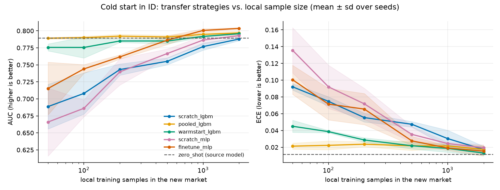
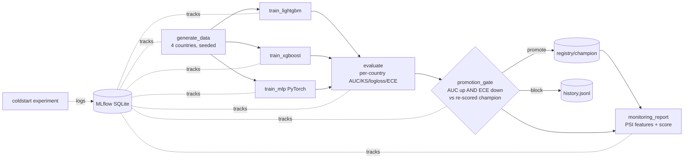
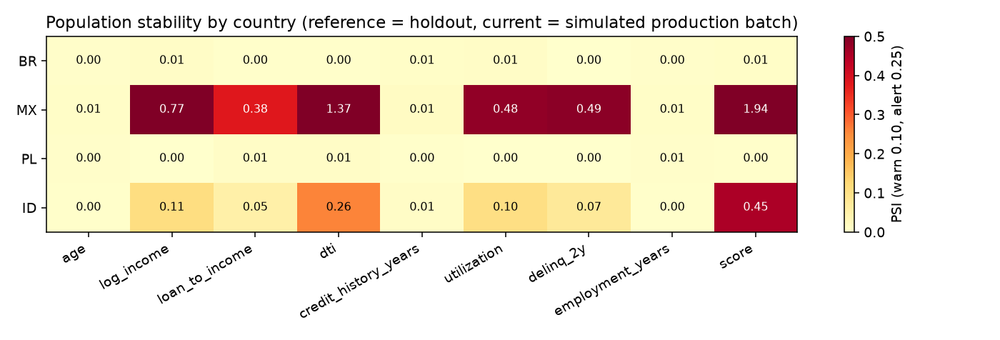

# BorderScore: Multi-Country Credit Risk Lab

> **Business question:** when a lender launches in a new country with almost no repayment history, how many local loans does it need before a locally trained model beats (or even matches) a model transferred from existing markets, and how do you keep that model safe once it is live?

An end-to-end, reproducible credit-default modeling pipeline that trains, calibrates, monitors and transfers models across several simulated countries, including a new market with little data. Everything runs locally on synthetic data: no downloads, no credentials.



*Headline result (new market "ID", AUC and ECE on 5,000 held-out loans, mean ± sd over 3 seeds): a LightGBM trained only on local data needs ~2,000 loans to reach AUC 0.788. A pooled model with a country feature gets there with 50 loans (the smallest size tested), and the source model applied as-is already scores 0.789 with zero local loans. Fine-tuned MLP overtakes all of them from ~1,000 loans.*

**One-line summary (CV):** Built a multi-country credit-risk ML platform (LightGBM/PyTorch, MLflow, Airflow) with champion/challenger gating and drift monitoring; cut the local data needed to match a from-scratch model in a new market by ≥97% in simulation (50 vs 2,000 loans, grid-limited; synthetic data, so the size of the effect is not a real-world estimate).

## Architecture



Tasks only exchange files in `artifacts/runs/<run_id>/` (CSV splits, joblib models, `evaluation.json`, `gate.json`), so the same functions run under the plain runner or Airflow's separate worker processes. The champion lives in `artifacts/registry/champion/` with a `history.jsonl` of every gate decision. MLflow data is in `artifacts/mlflow.db` (+ `artifacts/mlartifacts`).

```
src/borderscore/  config, data, metrics, models, coldstart, monitoring, registry, dag, tasks, tracking, cli
dags/             Airflow DAG       tests/   pytest suite       docs/   design doc, sample outputs
```

Design trade-offs and a one-year roadmap: [docs/design.md](docs/design.md).

## Features

- **Synthetic data generator** (`data.py`): 4 countries (BR, MX, PL, and the new market ID) with different default rates (4–14%), feature distributions and slightly different true risk functions. A `Shift(covariate, label)` knob adds controllable covariate shift (features drift) and label shift (log-odds of default move).
- **Training and tracking** (`models.py`, `tasks.py`, `tracking.py`): LightGBM and XGBoost baselines plus a PyTorch tabular MLP, all logged to MLflow (SQLite backend) with **AUC, KS, log-loss, ECE (and Brier) per country** and a macro average.
- **Cold-start experiment** (`coldstart.py`): train-from-scratch vs pooled training with a country feature vs warm-start (LightGBM) / fine-tuning (MLP) from the source countries, plotted against the number of local samples, with a zero-shot reference line.
- **Pipeline DAG** (`dag.py`, `tasks.py`, `dags/borderscore_dag.py`): generate data → train ×3 → evaluate → **promotion gate** → monitoring. Runs with a built-in dependency-free DAG runner, or as an Airflow DAG built from the same task table.
- **Monitoring** (`monitoring.py`): PSI per feature and for the score, per country, on a simulated drift scenario; Markdown + JSON report and a PSI heatmap.

## Setup

Python 3.10+ (developed on 3.14).

```bash
python3 -m venv .venv && . .venv/bin/activate
pip install -r requirements.txt -e .
cp .env.example .env   # optional; all values have defaults. Export them or use docker compose.
```

## Run

```bash
python -m borderscore pipeline              # full DAG; prints the gate decision (first run bootstraps the champion)
python -m borderscore pipeline --seed 7     # a new challenger: promoted only if it beats the champion
python -m borderscore coldstart             # ~1 min; writes artifacts/coldstart/{coldstart.png,summary.csv}
python -m borderscore monitor --run-id <id> [--no-drift]   # re-run monitoring for an existing run
mlflow server --backend-store-uri sqlite:///artifacts/mlflow.db --default-artifact-root artifacts/mlartifacts   # UI on :5000
```

Docker Compose: `docker compose run --rm pipeline`, `docker compose run --rm coldstart`, `docker compose up mlflow`, and `docker compose --profile airflow up airflow` for Airflow standalone (installs Airflow at start; UI on :8080, DAG `borderscore_pipeline`).
`make setup | test | pipeline | coldstart` are shortcuts.

## Test

```bash
python -m pytest -q     # 30 tests, ~20 s: generator, metrics, models, PSI/monitoring, gate, DAG runner, end-to-end pipeline, cold start
```

## Results from a sample run (seed 42)

Holdout, macro over countries: MLP AUC 0.810 / ECE 0.0087, XGBoost 0.809 / 0.0105, LightGBM 0.807 / 0.0103 (the MLP is chosen as challenger by *validation* AUC). Re-running with the same seed is correctly **not** promoted (no strict improvement); a different seed gave a slightly worse challenger and was also blocked.

Cold start in ID (AUC on 5,000 held-out ID loans, mean of 3 seeds; the zero-shot source model scores 0.789):

| local samples | scratch LGBM | pooled LGBM | warm-start LGBM | scratch MLP | fine-tuned MLP |
|---|---|---|---|---|---|
| 50 | 0.689 | 0.789 | 0.776 | 0.666 | 0.715 |
| 200 | 0.743 | 0.792 | 0.785 | 0.740 | 0.762 |
| 1000 | 0.777 | 0.795 | 0.792 | 0.787 | 0.801 |
| 2000 | 0.788 | 0.797 | 0.796 | 0.793 | 0.804 |

Takeaways: with ≤200 local samples, scratch models are clearly worse; pooling with a country feature is the most robust and best calibrated; fine-tuning the MLP overtakes everything once ~1,000 local samples exist. Note that in this synthetic world the source model transfers well zero-shot, and warm-starting with very little data does not beat it (it is slightly worse at n=50): transfer gains depend on how different the new market really is. Plot: `docs/coldstart.png`.


Monitoring scenario (`docs/sample_monitoring_report.md`): MX strong covariate shift → score PSI 1.94 (alert); ID moderate shift → score PSI 0.46; PL control → PSI ≈ 0.003; BR pure label shift → PSI ≈ 0.006 yet the default rate rises from 7.9% to 13% while mean score stays 8.9%, which only the calibration/default-rate columns reveal.



## Key design decisions

- **Pooled model with a one-hot country feature** for the main pipeline, evaluated per country; the new market has only 400 training rows by default (`BORDERSCORE_N_NEW`). Headline numbers are *macro* averages so small countries are not drowned out.
- **Fixed holdout seed.** Holdout data is identical in every run, so the gate can **re-score the current champion on the same data** as the challenger instead of trusting stored metrics. The challenger is picked by validation AUC, never by holdout, to avoid selection leakage.
- **Gate rule:** promote only if holdout macro AUC is strictly higher **and** macro ECE strictly lower, each beyond configurable margins (`BORDERSCORE_GATE_MIN_AUC_GAIN/ECE_GAIN`); with no champion, bootstrap-promote. Deliberately conservative.
- **ECE uses equal-frequency bins**, because with 4% defaults equal-width bins put nearly everything in one bin.
- **Label shift is applied after intercept calibration**, so it really changes the default rate; PSI cannot see it, which the monitoring report demonstrates. The reference for PSI is the holdout (not training data, which the model has overfit).
- **Cold-start fairness:** nested local subsets per seed, fixed hyper-parameters (no tuning on tiny samples), source models trained once per seed without a country indicator (the target is unseen). Warm start continues boosting (`init_model` / `xgb_model`) with a low learning rate; MLP fine-tuning keeps the source scaler.
- **Plain DAG + Airflow.** The runner is the tested default. `dags/borderscore_dag.py` reuses the same task table; Apache Airflow is not installed in the dev environment (it does not support the Python used here), so that DAG file is **not exercised by the test suite**. It is only run via the Docker `airflow` profile.
- **Model files are joblib pickles**, loaded only from the local run/registry directory; do not load untrusted artifacts.
- All shipped numbers are from synthetic data and say nothing about real credit portfolios.
